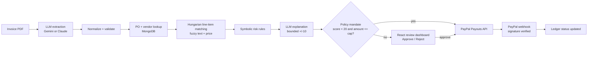

# LedgerPilot

**An autonomous Accounts Payable agent that reads vendor invoices, reconciles them against purchase orders, scores fraud risk, and pays safe invoices through PayPal Payouts. Anything suspicious goes to a human first.**

Built for the **PayPal AI Hackathon 2026**.

---

## The problem

Mid-size companies still process vendor invoices by hand: read the PDF, match it to a purchase order (PO), check the bank details, route an approval, then pay. It is slow, and it is the main route for invoice fraud (for example, a vendor's bank details quietly swapped on an invoice).

## What LedgerPilot does

1. **Ingests** an invoice PDF and extracts structured data with an LLM.
2. **Matches** invoice lines to the open PO using deterministic optimal assignment (Hungarian algorithm + fuzzy text matching), not an LLM guess.
3. **Scores risk** with a neuro-symbolic engine: hard rules produce the score, and the LLM explains it in plain language.
4. **Decides under a policy mandate**: low-risk invoices under the amount cap are paid automatically; everything else waits in a human review queue.
5. **Pays** through the PayPal Payouts API and tracks the result through signed PayPal webhooks.

## Architecture



**Stack:** Flask, MongoDB, React (Vite), Tailwind CSS 3, Gemini or Claude API, PayPal Payouts API.

## Key design decisions

- **Rules decide, the LLM explains.** The risk score comes from deterministic checks. The LLM can only nudge it by +/-10, and it can never move a rule-flagged invoice below the auto-approve threshold. A prompt-injected PDF therefore cannot talk its way into an automatic payout.
- **Policy mandate.** Auto-pay requires both a low risk score and an amount under `AUTO_PAY_MAX_AMOUNT`. Both are configurable.
- **Persist before pay.** The invoice is written to MongoDB before any money moves, so a payout can never exist without a ledger record.
- **Idempotent payouts.** The PayPal `sender_batch_id` is derived from the invoice ID, and approval uses an atomic claim in MongoDB. Double clicks and retries cannot pay twice.
- **Trusted vendor master data.** Bank details are verified against a `Vendors` collection, not against anything on the invoice.
- **Signed webhooks.** PayPal events are verified with the `verify-webhook-signature` API before the ledger changes.

## Risk rules

| Rule | Points |
|---|---|
| Invoice line has no matching PO line | +30 |
| Invoice total exceeds PO total | +20 |
| Bank details do not match the trusted vendor record | +70 |
| Invoice has no bank details to verify | +20 |
| Matched line has higher price or quantity than the PO | +20 |
| Duplicate invoice number for the same vendor | +60 |
| No open PO for the vendor | invoice rejected (score 100) |

The score is capped at 100. An invoice is auto-paid only if its score is below `AUTO_APPROVE_RISK_THRESHOLD` (default 20) and its total is at most `AUTO_PAY_MAX_AMOUNT` (default 5000).

## Project structure

```
.
├── backend/
│   ├── app.py              # Flask API, pipeline orchestration, webhook
│   ├── config.py           # env config, LLM provider layer (Gemini / Claude), mock toggle
│   ├── matcher.py          # Hungarian-algorithm line-item matching
│   ├── risk_engine.py      # symbolic rules + LLM explanation
│   ├── payment_gateway.py  # PayPal OAuth, Payouts, webhook verification
│   ├── seed_db.py          # demo PO + trusted vendor
│   ├── requirements.txt
│   └── .env.example
└── frontend/
    ├── src/App.jsx         # review dashboard (polls every 5s)
    ├── package.json
    └── .env.example
```

## Getting started

### Prerequisites

- Python 3.10+
- Node.js 20+
- MongoDB (local or Atlas)
- A PayPal Developer account with a **sandbox** business account (Payouts enabled and funded) and a sandbox personal account to receive money
- A Gemini or Anthropic API key (optional if you run in mock mode)

### 1. Backend

```bash
cd backend
python -m venv .venv
source .venv/bin/activate        # Windows: .venv\Scripts\activate
pip install -r requirements.txt
cp .env.example .env             # then fill in the values
```

Set `PAYPAL_RECEIVER_EMAIL` in `.env` **before** seeding, because the vendor's payout email is copied into MongoDB at seed time.

```bash
python seed_db.py
python app.py                    # http://127.0.0.1:5000
```

For production use `gunicorn app:app`.

### 2. Frontend

```bash
cd frontend
npm install
cp .env.example .env             # VITE_API_URL=http://127.0.0.1:5000
npm run dev                      # http://localhost:5173
```

### 3. Try it

Upload a PDF with **Upload Invoice PDF** in the dashboard.

## AI modes

Set these in `backend/.env`.

| Mode | Settings |
|---|---|
| Live, Gemini | `USE_MOCK_AI=false`, `AI_PROVIDER=gemini`, `GEMINI_API_KEY=...` |
| Live, Claude | `USE_MOCK_AI=false`, `AI_PROVIDER=anthropic`, `ANTHROPIC_API_KEY=...` |
| Mock | `USE_MOCK_AI=true` (no key, no network) |

The live integration is always present in the code. `USE_MOCK_AI=true` only swaps the LLM calls for hardcoded responses so the app can be developed and demoed when an API quota is exhausted.

**In mock mode**, the uploaded file content is ignored. A filename containing `fraud` (for example `fraud.pdf`) returns an invoice with a swapped bank account and an extra line item. Any other filename returns a clean invoice that matches the seeded PO. The deterministic matching, risk rules, policy mandate, and PayPal payout all run for real in both modes.

Live LLM calls retry up to 3 times with backoff on transient errors such as 429s.

## Configuration

All settings live in `backend/.env` (see `.env.example` for the full list).

| Variable | Purpose |
|---|---|
| `MONGO_URI`, `MONGO_DB_NAME` | Database connection |
| `USE_MOCK_AI`, `AI_PROVIDER` | AI mode (see above) |
| `GEMINI_API_KEY`, `GEMINI_MODEL` | Gemini settings |
| `ANTHROPIC_API_KEY`, `ANTHROPIC_MODEL` | Claude settings |
| `PAYPAL_MODE` | `sandbox` (default) or `live` |
| `PAYPAL_CLIENT_ID`, `PAYPAL_CLIENT_SECRET` | PayPal app credentials |
| `PAYPAL_RECEIVER_EMAIL` | Default payout recipient (also used when seeding) |
| `PAYPAL_WEBHOOK_ID`, `PAYPAL_VERIFY_WEBHOOKS` | Webhook verification |
| `AUTO_APPROVE_RISK_THRESHOLD`, `AUTO_PAY_MAX_AMOUNT` | Payout mandate |
| `CORS_ORIGINS` | Allowed frontend origins |

Never commit `.env`. Only `.env.example` files belong in the repository.

## PayPal webhooks (optional locally)

PayPal cannot reach `localhost`, so locally an invoice stays at `payout_initiated`. To see it move to `paid_successfully`:

1. Expose the backend, for example `ngrok http 5000`, or deploy it.
2. In the PayPal Developer Dashboard, add a webhook pointing to `<public-url>/api/paypal/webhook` for the Payouts batch and item events.
3. Put the webhook's ID in `PAYPAL_WEBHOOK_ID`.

For local development without a public URL, set `PAYPAL_VERIFY_WEBHOOKS=false`. Do not do this in production.

## API reference

| Method | Endpoint | Description |
|---|---|---|
| `GET` | `/api/health` | Database and mock-mode status |
| `POST` | `/api/upload-invoice` | Multipart upload, field `invoice` (PDF). Runs the full pipeline |
| `GET` | `/api/invoices` | Latest 200 invoices, newest first |
| `POST` | `/api/invoices/<id>/approve` | Human approval, triggers the payout |
| `POST` | `/api/invoices/<id>/reject` | Human rejection |
| `POST` | `/api/paypal/webhook` | PayPal event receiver |

### Invoice statuses

`flagged_for_human_review`, `payout_processing`, `payout_initiated`, `paid_successfully`, `payout_denied`, `payout_failed`, `rejected` (no PO), `rejected_by_human`

## Demo script

1. **Clean invoice:** upload a normal invoice. Risk score 0, auto-paid under the mandate.
2. **Fraudulent invoice:** upload one with swapped bank details and an extra line. It is flagged with a high score, a list of triggered rules, and an explanation.
3. **Human in the loop:** reject the fraudulent one, or approve a flagged one and watch the payout status update (the dashboard polls every 5 seconds).

## Known limitations

- The agent is a fixed pipeline, not an open-ended planning agent.
- There is no authentication or multi-user support. The dashboard assumes a single trusted operator.
- The project ships with one seeded vendor and PO, and there is no UI for managing vendors or POs.
- Only the PayPal Payouts API is used, and the project is tested against the PayPal sandbox only.
- There is no automated test suite yet.

## License

MIT. Add a `LICENSE` file before publishing.